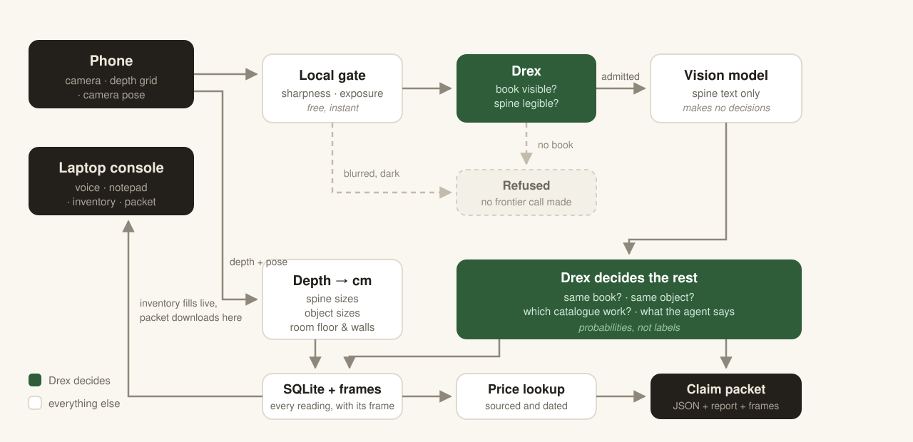
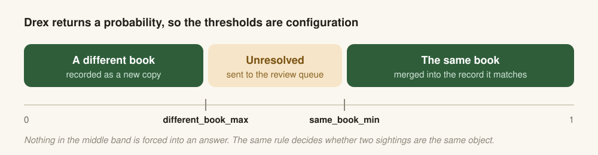
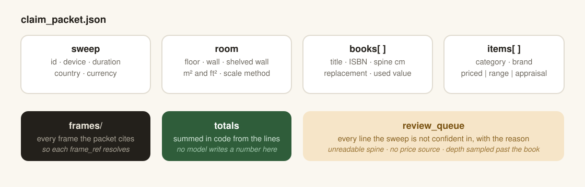

# Claims Assistant

A live voice-and-vision agent that walks a room with a policyholder and returns a contents
claim packet in which **every figure traces back to a saved frame and a dated source**.

The policyholder opens the app on a phone and starts talking. They walk the room once while
the camera runs. The agent directs the capture as it happens — slow down, step closer, steady
the camera — and when the sweep ends it produces `claim_packet.json` and a readable report:
every book identified from its spine and priced, every non-book object classified, and the
room's floor and wall area, all from the same pass.

Books are the hard case it is built around: dozens of near-identical objects on a shelf, most
partly hidden, each needing its own identity, size and price.


---

## Quick start

```sh
git clone <this repo> && cd cozmo-assignment
python3.13 -m venv .venv                      # 3.10+ required
.venv/bin/python -m pip install -r requirements.txt
cp .env.example .env                          # then add your keys
.venv/bin/python -m uvicorn live_demo.server:app --host 127.0.0.1 --port 4177
```

Open <http://127.0.0.1:4177>. Press **Talk** to speak to the agent, **Show camera** to let it
see, **Show inventory** for the tables, **Download claim packet** for the output.

### Keys

| Variable | Needed for | Without it |
| --- | --- | --- |
| `DREX_API_KEY` | every decision in the pipeline | frames are never admitted; nothing is read |
| `CRUSOE_API_KEY` | spine text and conversation | no titles, no replies |
| `GOOGLE_BOOKS_API_KEY` | catalogue and prices | Open Library still resolves titles; no prices |
| `DEEPGRAM_API_KEY` | speech in and out | type instead of talking |
| `PUBLIC_HOST` | serving through a tunnel | localhost only (the default) |

Everything else — models, thresholds, cadences — is in [`config.yml`](config.yml), documented in
[`docs/configuration.md`](docs/configuration.md).

---

## Architecture



The vision model sits behind the gate: it is sent a frame only after Drex has admitted it, so
it never receives a blurred shelf, a blank wall, or a book already recorded.

---

## Drex is the decision layer

Every judgement in the pipeline is a `drex-max-v1.1` call. The vision model does spine text and
the conversation; it makes no decisions.

| Decision | Question put to Drex | Module |
| --- | --- | --- |
| Frame admission | Is a book visible, and is its spine legible despite blur, glare or dark? | [`decisions/frame_check.py`](library_claim/decisions/frame_check.py) |
| Capture guidance | Which instruction should the agent speak now — or none? | [`live_demo/guidance_decision.py`](live_demo/guidance_decision.py) |
| Same book | Is this spine the same physical copy as one already recorded? | [`decisions/same_book.py`](library_claim/decisions/same_book.py) |
| Same object | Is this the same physical lamp, or another lamp? | [`decisions/same_object.py`](library_claim/decisions/same_object.py) |
| Catalogue match | Which candidate work is the book whose spine was read? | [`identification/catalogue.py`](library_claim/identification/catalogue.py) |
| Correction intent | Did they say "skip that", "it's a first edition", or something else? | [`decisions/corrections.py`](library_claim/decisions/corrections.py) |

Drex returns **calibrated probabilities, not labels**. Every threshold is therefore explicit
configuration, and the band between two thresholds is recorded as `unresolved` rather than
forced into a guess:



Because several questions about the same images travel in one request, one Drex call replaces a
handful of prompts.

### Measured result

**Drex acts as a decision gate, keeping 48% of frontier-model tokens off the wire.**

| 61 frames, 8 sweeps | Frontier calls | Frontier tokens |
| --- | --- | --- |
| Without Drex — vision model gates and reads | 102 | 81,761 |
| With Drex — Drex gates, vision model only reads | **41** | **42,599** |

20 of those frames were refused outright and never reached the vision model.

Reproduce:

```sh
.venv/bin/python scripts/drex_benchmark.py --limit 30        # admission vs the vision model
.venv/bin/python scripts/same_book_benchmark.py --pairs 12   # same-book, labelled from spine text
```

---

## What it refuses to do

- **No invented prices.** A price exists only with a retrievable URL and a retrieval date. No
  source, no figure — the line leaves the totals and says why in the review queue.
- **No guessed titles.** An unreadable spine is logged as an unidentified book with its
  dimensions, never a plausible title.
- **No measured-from-nothing.** Dimensions come from depth. A reading that could not belong to a
  book is refused, and the line records that the depth sampled past the spine.
- **No auto-priced art.** Framed art and mirrors wait for an appraiser unless the policyholder
  says the piece is a print.
- **Totals are summed in code** from the packet's own lines. No language model writes a number
  into `claim_packet.json`.

---

## The claim packet



Downloads as a zip holding `claim_packet.json`, `report.html`, and **every frame the packet
cites**, so each `frame_ref` resolves without a running server.

---

## Using a phone

The phone is the camera; the laptop keeps the conversation, the inventory and the packet.

| Route | How | Depth? |
| --- | --- | --- |
| **USB or wireless adb** | `adb reverse tcp:4177 tcp:4177`, open `http://localhost:4177/capture` | yes |
| **Tunnel** | `ngrok http 4177`, set `PUBLIC_HOST`, open the https URL | yes |
| **Same Wi-Fi, no tunnel** | not supported — localhost only by default | — |

Press **Use phone** on the laptop for a six-digit code, type it on the phone, press **Start
sweep**. WebXR depth needs a secure context, which both routes above provide; a phone whose
Chrome lacks `depth-sensing` falls back to the plain camera and reports no dimensions.

---

## Layout

```
library_claim/
  capture/         quality gates, frame tracking, evidence selection
  decisions/       the Drex client and every decision that uses it
  identification/  spine readings, association, catalogue resolution
  items/           non-book detection, association, valuation
  measurement/     spine sizes, room geometry from depth and pose
  pricing/         markets, providers, stored valuations
  storage/         SQLite repository, frame store, depth sidecars
  packet.py        claim_packet.json and report.html
live_demo/         FastAPI app, sweep console, phone capture page
scripts/           the two Drex benchmarks
tests/             388 Python tests, 52 browser tests
```

---


