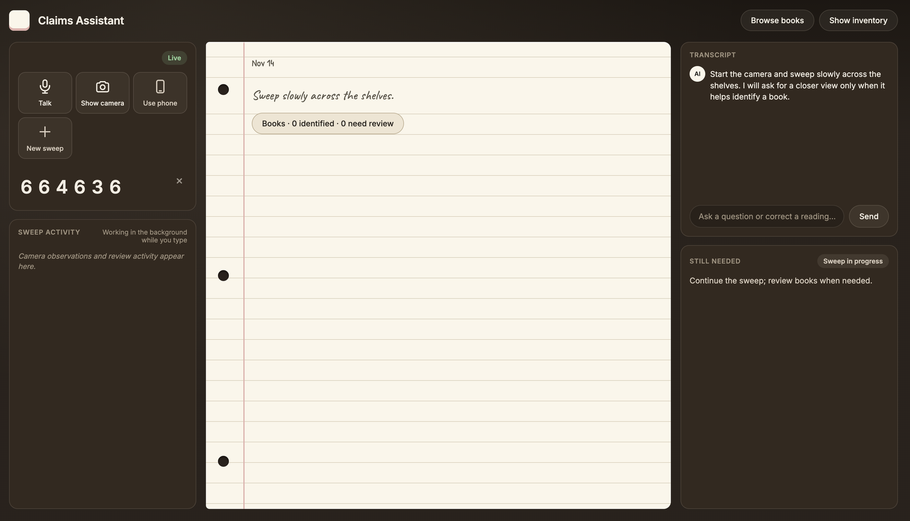
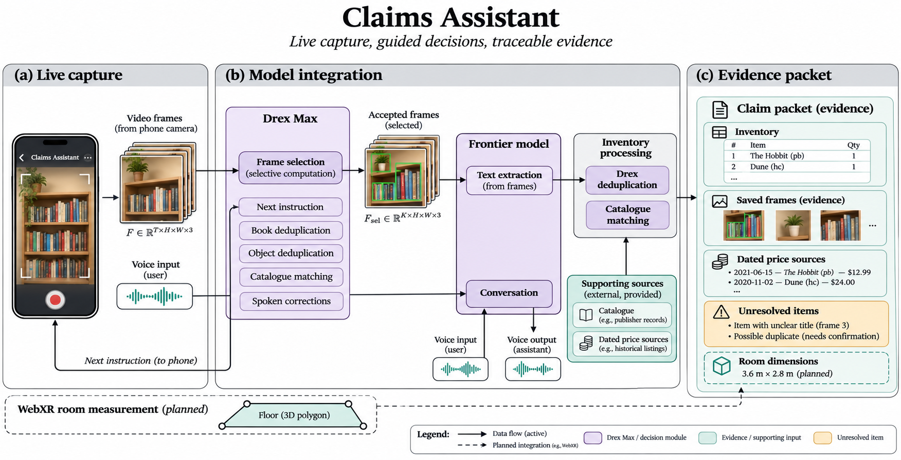

# Claims Assistant

A live voice-and-vision agent for home contents insurance claims. The policyholder walks their
room once with a phone camera running while talking to the agent. It produces a claim packet in
which every book, every object and the room's own dimensions trace back to a saved frame and a
dated price source.



## Features

- Live voice capture, with the agent directing the sweep as it happens
- Books identified from the spine, resolved against Google Books and Open Library
- Spine sizes in centimetres from WebXR depth
- Non-book contents detected and classified: shelving, seating, lighting, electronics, art
- Room floor area, wall area, ceiling height and shelved wall area, in m² and ft²
- Replacement cost per book in the policyholder's market, each with a source URL and date
- Phone as the camera, laptop as the console
- A review queue listing every uncertain line with its reason

## Requirements

- Python 3.10 or newer
- Node.js, to run the browser tests
- An Android phone with Chrome, for depth measurement (optional)

## Installation

```sh
git clone <repository-url> && cd cozmo-assignment
python3 -m venv .venv
.venv/bin/python -m pip install -r requirements.txt
cp .env.example .env
```

Add your API keys to `.env`:

| Variable | Used for | Required |
| --- | --- | --- |
| `DREX_API_KEY` | every decision in the pipeline | yes |
| `CRUSOE_API_KEY` | spine text extraction and conversation | yes |
| `GOOGLE_BOOKS_API_KEY` | catalogue lookups and prices | recommended |
| `DEEPGRAM_API_KEY` | speech in and out | optional |
| `PUBLIC_HOST` | serving through a tunnel | optional |

## Usage

```sh
.venv/bin/python -m uvicorn live_demo.server:app --host 127.0.0.1 --port 4177
```

Open <http://127.0.0.1:4177>.

### Using a phone as the camera

**Use phone** shows a pairing code to enter at `/capture` on the phone. The phone needs a
secure context to reach the server, either over adb or through a tunnel:

```sh
adb reverse tcp:4177 tcp:4177     # open http://localhost:4177/capture
ngrok http 4177                   # or set PUBLIC_HOST to the tunnel host in .env
```

Depth measurement needs Chrome with WebXR `depth-sensing`; without it the sweep runs on the
plain camera and records no dimensions.

## Architecture



Drex Max makes every decision in the pipeline. The vision model is called only on frames Drex
has admitted, and does text extraction and conversation.

| Decision | Question | Module |
| --- | --- | --- |
| Frame admission | Is a book visible, and is its spine legible? | [`decisions/frame_check.py`](library_claim/decisions/frame_check.py) |
| Capture guidance | Which instruction should the agent speak? | [`live_demo/guidance_decision.py`](live_demo/guidance_decision.py) |
| Same book | Is this the same physical copy as one already recorded? | [`decisions/same_book.py`](library_claim/decisions/same_book.py) |
| Same object | Is this the same physical object, or another like it? | [`decisions/same_object.py`](library_claim/decisions/same_object.py) |
| Catalogue match | Which candidate work matches this spine? | [`identification/catalogue.py`](library_claim/identification/catalogue.py) |
| Correction intent | What did a spoken correction mean? | [`decisions/corrections.py`](library_claim/decisions/corrections.py) |

Drex returns probabilities rather than labels, so thresholds are configuration; a value
between `different_book_max` and `same_book_min` is recorded as `unresolved`.

Gating with Drex rather than the vision model cuts frontier-model tokens by 48%:

```sh
.venv/bin/python scripts/drex_benchmark.py --limit 30
.venv/bin/python scripts/same_book_benchmark.py --pairs 12
```

## Output

Each sweep produces `claim_packet.json` and `report.html`, downloaded as a zip together with
every frame the packet cites, so each `frame_ref` resolves offline.

```jsonc
{
  "sweep":  { "id": "…", "device": "…", "duration_s": 0, "country": "US", "currency": "USD" },
  "room":   { "floor_area_m2": 0, "wall_area_m2": 0, "shelved_wall_area_m2": 0, "scale_method": "…" },
  "books":  [ { "title": "…", "isbn": "…", "spine_height_cm": 0, "replacement_cost": { } } ],
  "items":  [ { "category": "…", "status": "priced | range | needs_appraisal" } ],
  "totals": { "book_count": 0, "books_replacement_cost": 0, "excluded_from_totals": 0 },
  "review_queue": [ { "ref_id": "…", "reason": "…" } ]
}
```

- Prices carry a retrievable URL and a retrieval date; unpriced lines are excluded from the
  totals and listed in the review queue.
- An unreadable spine is recorded as an unidentified book with its dimensions.
- Dimensions come from measured depth.
- Framed art and mirrors are `needs_appraisal` unless the user states the piece is a print.
- Totals are computed in code from the packet's lines.

## Configuration

Models, thresholds, capture cadence and pricing markets are in [`config.yml`](config.yml) and
documented in [`docs/configuration.md`](docs/configuration.md). Adding a country is a `markets`
entry; no code changes.

## Project structure

```
library_claim/
  capture/         quality gates, frame tracking, evidence selection
  decisions/       Drex client and the decisions that use it
  identification/  spine readings, association, catalogue resolution
  items/           non-book detection, association, valuation
  measurement/     spine sizes, room geometry from depth and pose
  pricing/         markets, providers, stored valuations
  storage/         SQLite repository, frame store, depth sidecars
  packet.py        claim_packet.json and report.html
live_demo/         FastAPI app, sweep console, phone capture page
scripts/           benchmarks
tests/
```

## Tests

```sh
.venv/bin/python -m unittest discover -s tests   # 388 tests
node tests/client-regressions.cjs                #  29, sweep console
node tests/inventory-regressions.cjs             #  13, inventory tables
node tests/capture-regressions.cjs               #   5, phone capture
node tests/voice-regressions.cjs                 #   5, microphone and playback
```

No test makes network calls; external services are stubbed with `httpx.MockTransport` or
injected callables.
